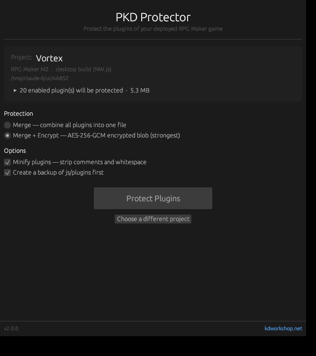

# PKD Protector

A free, open-source desktop tool that protects the plugins of a deployed **RPG Maker MV / MZ** game. Drop your release build into the window, choose the protection, and click **Protect Plugins**.

PKD Protector merges your enabled plugins into a single file and can encrypt the result, so the plugin code shipped with your game is no longer a set of readable files that can simply be copied into another project.

**[Download & installation](#download--installation)** · **[Build from source](#build-from-source)** · **[MIT license](LICENSE)**

## Screenshot



## Features

- **Drag-and-drop workflow:** drop the deployed project folder into the window, onto the `.exe` icon, or pick it with **Browse**.
- **Automatic project detection:** recognizes RPG Maker MZ (files in the root) and MV (files in `www/`) deployments and shows the game title.
- **Merge:** all enabled plugins are combined, in load order, into one file. Plugin parameters keep working because `plugins.js` is not changed.
- **Merge + Encrypt:** the merged code is encrypted with AES-256-GCM and decrypted by a small loader when the game starts.
- **Minify (optional):** removes comments, help text, and formatting from readable plugins. Already-obfuscated plugins are left exactly as they are.
- **Backup (optional):** copies `js/plugins` to a timestamped folder before any change.
- **Safety checks:** refuses editor (working) projects and projects that were already protected, and asks for confirmation with a 3-second lock on **Yes**.
- **Single small executable:** about 6 MB, no installer or runtime required.

## Download & Installation

1. Open this repository's **[Releases](../../releases)** page.
2. Under **Assets**, download the Windows application archive. The **Source code** archives are for developers building the application themselves.
3. Extract the archive to a folder of your choice.
4. Run **`PKD_Protector.exe`**. No installation is required.

Windows is the current distribution platform. Linux and macOS builds have not yet been verified; see [Build from source](#build-from-source) if you want to try building for your system.

## Quick Start

1. In RPG Maker, deploy your game with **File > Deployment**.
2. Start PKD Protector and drop the **deployed** folder into the window (the one with `Game.exe` for MZ, or the folder containing `www/` for MV).
3. Choose **Merge** or **Merge + Encrypt**, and set the **Minify** and **Backup** options.
4. Click **Protect Plugins** and confirm.
5. Run the game once to check that everything works.
6. Delete the `_PKD_Protector_Backup_<time>` folder before publishing your game.

> **Always protect a deployed copy, never your working project.** The changes cannot be undone except by restoring the backup.

## Protection Options

| Option | What it does |
| --- | --- |
| **Merge** | Enabled plugins are merged into the first enabled plugin file; the other plugin files become empty. Disabled plugins are not touched. |
| **Merge + Encrypt** | The merged code is encrypted (AES-256-GCM) and the plugin file is replaced by a loader that decrypts it at game start. Requires the NW.js desktop runtime (`Game.exe`). |
| **Minify** | Strips comments, help text, and whitespace from readable plugins. Obfuscated third-party plugins (for example VisuStella) are never modified. On by default. |
| **Backup** | Copies `js/plugins` to `_PKD_Protector_Backup_<time>` inside the project folder before protecting. On by default. |

## Supported Projects & Limitations

- RPG Maker **MZ** and **MV** deployments. Editor projects (with `*.rmmzproject` / `*.rpgproject`) are refused.
- **Merge + Encrypt** works only in desktop (NW.js) builds. Web and mobile deployments can use **Merge**.
- The encryption key is stored inside the game, so encryption protects against casual copying, not against a determined reverse engineer.
- Plugins that rely on `document.currentScript` may behave differently after merging; PKD Protector shows a warning for them.
- Identifier mangling is intentionally not used, because it breaks already-obfuscated third-party plugins.

## Build from Source

### Prerequisites

Install **Git** and the latest stable **Rust** toolchain using the [official Rust installation instructions](https://rust-lang.org/tools/install/).

- **Windows:** install Visual Studio Build Tools with the **Desktop development with C++** workload and a Windows SDK. Use Rust's MSVC toolchain. The SDK's resource compiler embeds the application icon; without it the build still succeeds, only the `.exe` icon is missing.
- **Linux:** install a C/C++ toolchain and the desktop development libraries required by [eframe](https://github.com/emilk/egui/tree/main/crates/eframe#readme).

### Compile and Run

```sh
git clone https://github.com/KageDesu/PKD_Protector.git PKD_Protector
cd PKD_Protector
cargo build --release --locked
```

The executable is created at `target/release/PKD_Protector.exe` (Windows) or `target/release/PKD_Protector` (Linux / macOS).

To build and launch directly through Cargo:

```sh
cargo run --release --locked
```

### Project Layout

| Folder | Contents |
| --- | --- |
| `core/` | Platform-independent logic: project detection, merging, minification ([oxc](https://oxc.rs/)), encryption. Covered by unit tests. |
| `app/` | The desktop interface built with [egui / eframe](https://github.com/emilk/egui). |

Run the tests:

```sh
cargo test -p protector_core
```

## Feedback & Contributions

Bug reports, feature suggestions, and pull requests are welcome through this repository's **Issues** and **Pull requests** tabs. For a bug report, include your RPG Maker version (MV or MZ), the protection options you used, and the error message from the game console, if any.

## License & Credits

Created by **Pheonix KageDesu** — [KD Workshop](https://kdworkshop.net/).

PKD Protector is open source and licensed under the **[MIT License](LICENSE)**.

The MIT license covers the application source code. Plugins you protect with this tool remain subject to their authors' licenses and terms of use.
